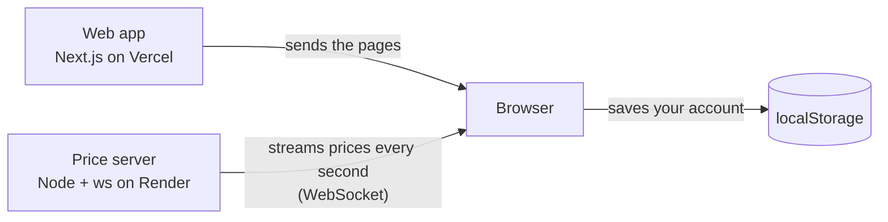

# Paper Trading

A web app for practicing trading with fake money: live simulated prices,
mock buying and selling, and gains and losses that update as the "market"
fluctuates.

**Live demo: <https://paper-trading-cyan.vercel.app/>**
The price server runs on a free tier and sleeps when idle, so the first load
can take up to a minute to wake up.

_No one's wallet will be hurt in the process of using this app._

## Features

- Live prices for six stocks (AAPL, MSFT, GOOG, AMZN, TSLA, NVDA), pushed over
  a WebSocket once per second
- Buy and sell from a starting balance of $100,000
- Portfolio tab with shares, current value, and gain or loss per position
- History tab with every trade, newest first
- Responsive: a side panel on desktop, a swipeable bottom sheet on phones

## Tech stack

- **Web:** Next.js 16 (App Router), React 19, TypeScript, Tailwind CSS 4
- **Realtime:** Node 24 and `ws`
- **Tooling:** Biome (lint and format), Vitest (web), Node's test runner
  (realtime), GitHub Actions CI

## How it's built



- `web/` is the Next.js app and `realtime/` is a small separate service that
  generates simulated prices and broadcasts them
- Prices and the account are shared through React context providers in the
  shared layout, so every tab reads the same data
- Each tab (Market, Portfolio, History) is its own route with its own URL

## Limitations

- The free Render server sleeps after 15 minutes without incoming traffic. An
  open tab can freeze, and a refresh reconnects.
- Prices are a random walk (at most 0.5% per tick), not market data.
- In v1 the browser supplies the trade price and the account exists only in
  that browser. v2 moves both to the server.

## Run it locally

Needs Node 24 (see `.nvmrc`).

```bash
# terminal 1: price server (ws://localhost:8080)
cd realtime
npm install
npm run dev

# terminal 2: web app (http://localhost:3000)
cd web
npm install
npm run dev
```

To point the web app at a different price server, set
`NEXT_PUBLIC_REALTIME_URL` in `web/.env.local`.

Checks: `npm test` in each folder, plus `npm run lint` in `web`. CI runs lint,
tests, and the build.


