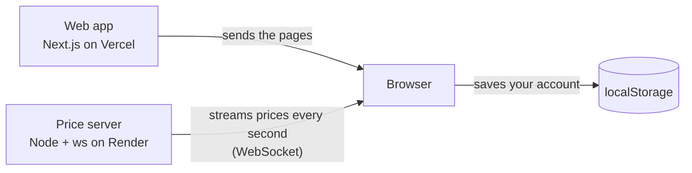

# Paper Trading

A web app for practicing trading with fake money: live simulated prices,
mock buying and selling, and gains and losses that update as the "market"
fluctuates.

**Live demo: <https://paper-trading-cyan.vercel.app/>**
The price server is on Render's free tier and sleeps when idle, so the first
load can take up to a minute.

_No one's wallet will be hurt in the process of using this app._

## Features

- Live prices for six stocks (AAPL, MSFT, GOOG, AMZN, TSLA, NVDA), pushed over
  a WebSocket once per second
- Buy and sell from a starting balance of $100,000
- Portfolio tab with shares, current value, and gain or loss per position
- History tab with every trade, newest first
- Responsive: a side panel on desktop, a swipeable bottom sheet on phones

## Tech stack

- **Web:** Next.js 16 (App Router), React 19, TypeScript, Tailwind CSS 4
- **Realtime:** Node 24 and `ws`
- **Hosting:** Vercel (web app) and Render's free tier (price server)
- **Tooling:** Biome (lint and format), Vitest (web), Node's test runner
  (realtime), GitHub Actions CI

## How it's built



`web/` is the Next.js app. `realtime/` is a small separate service that
generates the simulated prices and broadcasts them.

## Decisions

I release this app in versions. The first one is a small working demo with
only the core features above. I skipped the backend on purpose, to get
something live first.

### A separate real-time service

I use a separate Node.js service for the WebSockets because I need a server
that can keep connections open and send prices all the time. Keeping it
separate from Next.js also means I can deploy and scale the two on their own.
The Next.js app is on Vercel, which suits pages but doesn't fit long-lived
connections well, so the price server runs on Render.

### Next.js

I'm using Next.js in this project to practice with it, since it's widely used
in the industry. I use it lightly: the tabs are routes and the rest is plain
React. Without it, this would be a React app with a router and the same price
server.

### Money in cents

I store every amount as whole cents, so there are no decimal bugs. Dollar
strings like "$189.40" only appear when displaying.

### Tabs are routes

Market, Portfolio and History are separate routes, so each one has its own
URL, and refresh and the back button work. The providers for prices and the
account sit in the shared layout, so every tab reads the same data and the
connection stays open when you switch tabs.

### Everything runs in the browser (v1)

The account is saved in `localStorage` and trades are made in the browser, so
the account doesn't follow the user across devices. The browser also supplies
the trade price, which isn't suitable for a real trading app. In v2 the server
takes over: it stores the account, checks orders, and decides the price. All
the storage code is in `web/lib/api.ts`, and its functions are async like API
calls, so a backend can replace it without touching the components.

### Tests for the logic, not the UI

I wrote tests where a bug would really hurt or is easy to get wrong: the money
math (buying, selling, average cost, gain and loss), how amounts are
displayed, and the price simulator. I didn't test the UI.

### Scaling the price updates

Right now the service sends all six prices once per second to every client.
That's enough for v1.

With more users and stocks, I would let clients subscribe only to the stocks
they need, after measuring CPU, memory, bandwidth and message delay to find
the bottleneck. If one instance couldn't cope, I would find out why first,
then improve the code or move to a bigger plan. With more than one instance,
they would need to share the prices, because each one makes its own right now.

For a demo with six stocks, I'm keeping it simple.

## Limitations

- The free Render server sleeps after 15 minutes without incoming traffic. An
  open tab can freeze (refresh to reconnect), and prices only move while the
  server is awake.
- The account lives in one browser. It doesn't follow you to another device,
  and clearing the browser's data deletes it.
- Trades are made in the browser, so they aren't secure.
- Prices are a random walk (at most 0.5% per tick), not market data.

## Run it locally

Needs Node 24 (see `.nvmrc`).

```bash
# terminal 1: price server (ws://localhost:8080)
cd realtime
npm install
npm run dev

# terminal 2: web app (http://localhost:3000)
cd web
npm install
npm run dev
```

To point the web app at a different price server, set
`NEXT_PUBLIC_REALTIME_URL` in `web/.env.local`.

Checks: `npm test` in each folder, plus `npm run lint` in `web`. CI runs lint,
tests, and the build.

## Roadmap

**Next: v2, accounts.** What I plan to include:

- Sign up and sign in, with accounts and trades stored in a database so they
  follow you across devices
- The server decides the trade price
- **Watchlist:** a star on each Market row to watch or unwatch a symbol,
  saved with your account. Watched rows are marked in the same table instead
  of a second list, because the symbol list is small. It gets its own tab if
  the list grows.
- **Reconnect:** recover automatically when the connection drops
